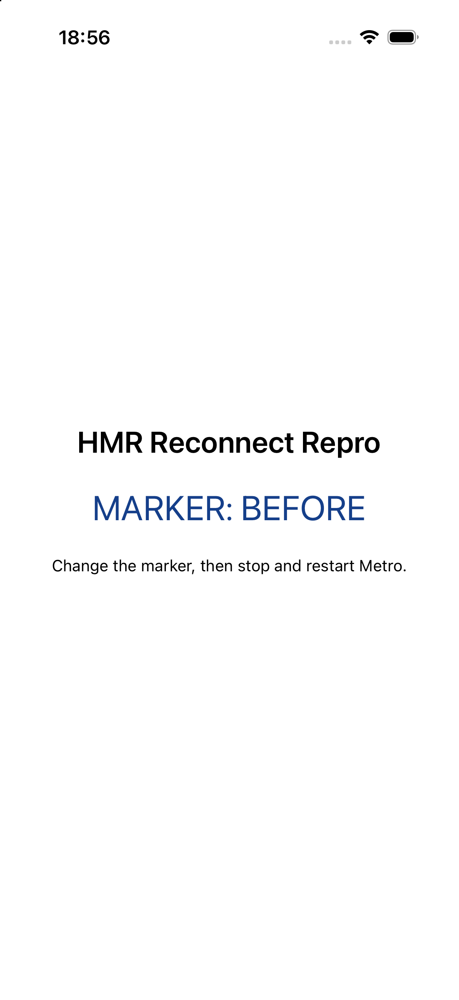
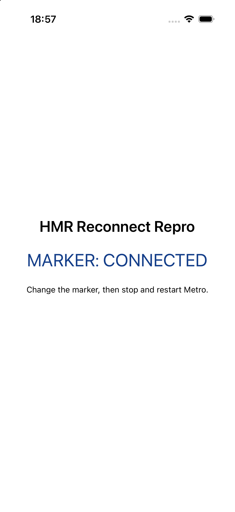
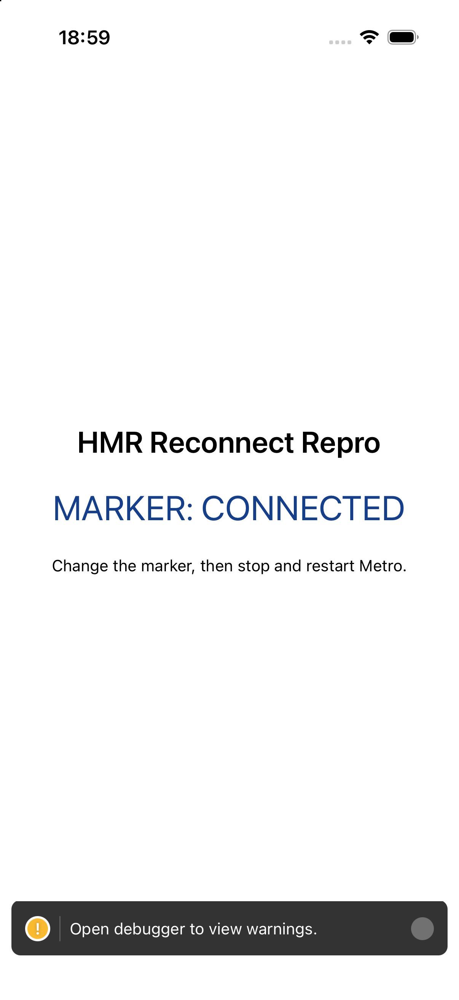
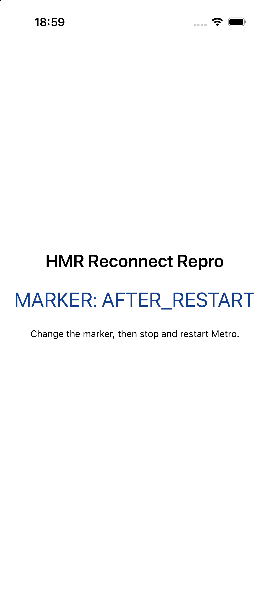
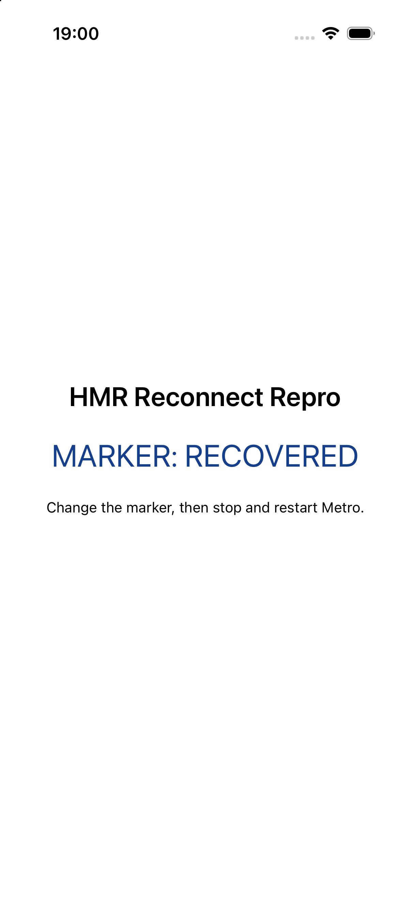

# Expo SDK 57 — Fast Refresh recovery after Metro restart

A minimal native iOS app for checking whether Fast Refresh reconnects after its Metro process is stopped and restarted on the same port.

## Reproduction

Requires macOS, Xcode with an iOS simulator, Node.js, and CocoaPods. This is a native Debug build, not a web reproduction or Expo Go session.

```sh
npm ci
npm run ios
```

1. Keep the native app open. It displays `MARKER: BEFORE`.
2. Change `BEFORE` to `CONNECTED` in `App.js`. Confirm Fast Refresh shows `MARKER: CONNECTED` without reloading the app. This is the healthy control.
3. Stop the Metro process started for this repository using Ctrl+C. Do not close or reload the simulator app.
4. Restart Metro in the same repository on the same port: `npm start` (port 8097).
5. Change `CONNECTED` to `AFTER_RESTART` in `App.js`. Wait at least 30 seconds without reloading the app and observe the visible marker.
6. Reload the app manually with the simulator's developer menu or Metro's `r` command. Check whether `AFTER_RESTART` now appears.
7. Change `AFTER_RESTART` to `RECOVERED`. Check whether Fast Refresh works again after the manual reload.

There are no native third-party modules, auth, remote servers, tunnels, proxies, or custom Metro configuration. `ios/` is generated by Expo and intentionally not committed. The lockfile preserves the exact transitive package versions used in the experiment.

## Native simulator observation

Observed on an iPhone 17 Pro simulator running **iOS 26.5**, with the native Debug app built locally using Xcode 27.0. This was one native build, followed by one Metro stop/restart experiment; no phone or existing app was used.

| Step | Observed result |
| --- | --- |
| Initial launch | `MARKER: BEFORE` rendered. |
| Healthy edit, no reload | `MARKER: CONNECTED` appeared through Fast Refresh. |
| Stop Metro, leave app open | The app retained `CONNECTED`. |
| Restart the same Metro port and edit to `AFTER_RESTART` | Metro was running again, but the app still displayed `CONNECTED` after a 30-second observation window. A warning indicator appeared. |
| Manual reload using Metro's `r` | `MARKER: AFTER_RESTART` appeared; Metro logged a fresh iOS bundle. |
| Next edit, no additional reload | `MARKER: RECOVERED` appeared through Fast Refresh again. |

**Result:** Fast Refresh did not recover automatically after Metro restarted. A full JS reload recovered it; neither another native build nor an app reinstall was required.

The failure arm is a **previously connected socket being closed**, not a failed first connection. The saved-error behavior for an initial connection failure is established by the source links below, not by a separate native initial-connection experiment.

### Screenshots

| Initial render | Healthy Fast Refresh | Metro stopped |
| --- | --- | --- |
|  |  |  |

| Restarted, stale after 30 seconds | Manual reload recovery | Fast Refresh restored |
| --- | --- | --- |
|  |  |  |

### Native build method

The experiment used `expo prebuild --platform ios --no-install`, CocoaPods, then this Debug simulator build (artifact directory shown as `build` for portability):

```sh
xcodebuild \
  -workspace ios/HMRReconnectRepro.xcworkspace \
  -scheme HMRReconnectRepro \
  -configuration Debug \
  -sdk iphonesimulator \
  -destination 'generic/platform=iOS Simulator' \
  -derivedDataPath build \
  CODE_SIGNING_ALLOWED=NO RCT_METRO_PORT=8097 \
  -jobs 2 build
```

The build exited successfully with `** BUILD SUCCEEDED **`. The generated `.app` was installed and launched in an isolated simulator. Metro ran with `CI` unset and `npm start -- --max-workers 2`; the healthy control proves watch mode was active. Restart readiness was confirmed by `/status` returning `packager-status:running` on the same loopback port before the failure-arm observation.


## Versions

- `expo`: 57.0.27
- `@expo/metro-runtime`: 57.0.16
- `react-native`: 0.86.3
- `react`: 19.2.3
- `metro-runtime`: 0.84.5 (transitive)
- `@expo/cli`: 57.0.28 (transitive)
- Node.js: 24.20.0
- npm: 11.19.0
- CocoaPods: 1.16.2
- Xcode: 27.0 (27A266a)
- macOS: 27.0.1, arm64
- Simulator: iPhone 17 Pro, iOS 26.5

## Source interpretation

In SDK 57, the active Expo HMR wrapper is `expo/src/async-require/hmr.ts`, **not** a `HMRClient` file in `@expo/metro-runtime`. Expo CLI [replaces React Native's native HMR wrapper with Expo's](https://github.com/expo/expo/blob/50ac74f1ab5682c8e32b24da6e5e97dd4dbbb80f/packages/%40expo/cli/src/start/server/metro/withMetroMultiPlatform.ts#L841-L845).

- Expo [stores the first unavailable reason](https://github.com/expo/expo/blob/50ac74f1ab5682c8e32b24da6e5e97dd4dbbb80f/packages/expo/src/async-require/hmr.ts#L295-L315), including [a connection error](https://github.com/expo/expo/blob/50ac74f1ab5682c8e32b24da6e5e97dd4dbbb80f/packages/expo/src/async-require/hmr.ts#L195-L197) or [a socket close](https://github.com/expo/expo/blob/50ac74f1ab5682c8e32b24da6e5e97dd4dbbb80f/packages/expo/src/async-require/hmr.ts#L235-L251). Its [`enable()` throws that saved reason](https://github.com/expo/expo/blob/50ac74f1ab5682c8e32b24da6e5e97dd4dbbb80f/packages/expo/src/async-require/hmr.ts#L53-L61).
- React Native 0.86.3 has [the same saved-reason guard](https://github.com/react/react-native/blob/95cffbff2e071e278987c7d7cd51fbc970dd5622/packages/react-native/Libraries/Utilities/HMRClient.js#L61-L69) and [first-reason storage](https://github.com/react/react-native/blob/95cffbff2e071e278987c7d7cd51fbc970dd5622/packages/react-native/Libraries/Utilities/HMRClient.js#L298-L320). This is source context, not a claim that a separate bare-RN app was run.
- Both use Metro's lower-level HMR client. Metro 0.84.5 [constructs a single WebSocket and marks it closed on `onclose`](https://github.com/react/metro/blob/b71015ef83904e7086342ddb72205b7242dcd129/packages/metro-runtime/src/modules/HMRClient.js#L46-L65). [`send()` ignores a closed socket](https://github.com/react/metro/blob/b71015ef83904e7086342ddb72205b7242dcd129/packages/metro-runtime/src/modules/HMRClient.js#L114-L128), and [`enable()` only applies pending updates](https://github.com/react/metro/blob/b71015ef83904e7086342ddb72205b7242dcd129/packages/metro-runtime/src/modules/HMRClient.js#L151-L158); neither recreates the socket.

**These are two separate mechanisms.** The saved error prevents a later `enable()` in the same JS runtime; it does not disable an otherwise-existing reconnect loop. The lower-level HMR socket has no reconnect loop. The reason is retained for that JS runtime, not persisted across a full reload. The existing source explicitly recommends reloading the app after disconnection; this report does not claim a newly introduced SDK 57 regression or that the error latch alone causes the transport failure.

## Diagnostics

`expo-doctor` completed with `21/21 checks passed. No issues detected!` using CocoaPods 1.16.2 in the command environment. No package overrides or dependency-mismatch workarounds were used.
